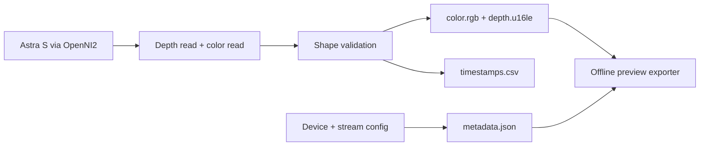

# Astra RGB-D Recorder

**Capture the stream. Keep the timestamps. Make the data inspectable.**

[](https://github.com/tolegengca/astra-rgbd-recorder/actions/workflows/tests.yml)


[](LICENSE)

A small, inspectable RGB-D recording tool for Orbbec Astra S / OpenNI2 setups, designed around Raspberry Pi capture sessions. It writes raw color and depth frames alongside sensor timestamps, host clocks, camera settings, and a session summary.

The design favors a simple data contract over per-frame image encoding: record sequential binary streams, then generate previews offline. The repository includes a camera recorder, preview exporter, systemd template, udev rule, and camera-free format tests.

> **Hardware status:** this public release is a prototype. The publication checks validate the binary/preview contract; they do not certify camera compatibility, sustained FPS, or hardware synchronization.

## Data flow



## Why raw streams?

- **Exact values:** RGB888 color and little-endian uint16 depth values are stored without lossy compression.
- **Simple indexing:** frame `i` starts at a calculable byte offset, with no image-container parsing.
- **Deferred work:** preview PNG generation happens after recording instead of consuming capture-time encoding work.
- **Traceable sessions:** requested synchronization/registration status and stream dimensions are recorded rather than assumed.

At the default 640 × 480 / 30 FPS configuration, raw RGB + depth payload is approximately **46.1 MB/s, or 2.76 GB/minute** before metadata and filesystem overhead. This is a format calculation, not a measured device throughput result. Use storage sized and tested for the intended session.

## Camera-free quick start

Python 3.10+; no OpenNI2 installation is needed for this demonstration.

```bash
git clone https://github.com/tolegengca/astra-rgbd-recorder.git
cd astra-rgbd-recorder
python3 -m venv .venv
source .venv/bin/activate
python -m pip install -r requirements-preview.txt
python scripts/make_example_session.py
python scripts/export_preview.py recordings_example/synthetic --frame 0
```

This produces a clearly labeled **synthetic** session and three PNGs: RGB, depth visualization, and raw 16-bit depth. It verifies the inspectable file format without pretending to be a camera capture.

## Record on Raspberry Pi

Recommended starting point: Raspberry Pi 4/5, a reliable power supply, and storage tested for sustained writes. An Astra S can be mounted separately while the Pi and power bank remain off-head.

```bash
bash setup_pi.sh
source .venv/bin/activate
```

Install an Orbbec/OpenNI2 runtime compatible with your camera, OS, and CPU architecture separately. The Python package alone does not install the native camera runtime.

```bash
sudo cp udev/56-orbbec.rules /etc/udev/rules.d/
sudo udevadm control --reload-rules
sudo udevadm trigger

python astra_record.py \
  --openni2-lib /path/to/OpenNI2/Redist \
  --duration-sec 10 --out recordings_test
```

Then inspect the session summary and preview before attempting a longer recording:

```bash
python astra_record.py --duration-min 10 --out /media/pi/SSD/astra_recordings
python scripts/export_preview.py /path/to/session --frame 0
```

Use `--fps`, `--color-width`, `--color-height`, `--depth-width`, and `--depth-height` to request supported modes. Registration and depth/color synchronization are requested by default; `--no-registration` and `--no-depth-color-sync` disable those requests. Inspect `metadata.json` to see whether the device accepted them.

## Session contract

```text
session/
├── metadata.json   device, modes, format and sync/registration status
├── timestamps.csv  pair index, sensor frame IDs, sensor and host timestamps
├── color.rgb       contiguous RGB888 frames
├── depth.u16le     contiguous little-endian uint16 depth frames
├── summary.json    written pairs, bad frames, elapsed time, approximate FPS
└── notes.txt       operator notes
```

For frame `i`, offsets are `i × width × height × 3` bytes for RGB and `i × width × height × 2` bytes for depth. Each stream has its own dimensions. The preview exporter uses the dimensions in the metadata.

See [the exact format](docs/FORMAT.md) and [validation](docs/VALIDATION.md).

## Timing: explicit rather than implied

Frames are read sequentially. The CSV records each sensor timestamp and a host timestamp taken after the reads. A hardware-sync request is **not** proof of timestamp alignment or simultaneous exposure. Inspect sensor deltas, frame IDs, and actual frame rate for your camera/runtime combination before using a session for sensor-fusion experiments.

`bad_frames` counts rejected reads/shapes. It is not an exhaustive dropped-frame detector; inspect sensor frame-index gaps separately. Flushing userspace buffers is not an `fsync` durability guarantee.

## Unattended operation

`systemd/astra-recorder.service` is a template using `/home/pi/astra_egocentric_recorder`. Edit the user, working directory, output disk, and OpenNI2 path for your deployment before installing it. An unbounded recording can fill the disk; configure an appropriate duration or external retention policy.

## Tests

```bash
python -m pip install -r requirements-dev.txt
python -m pytest -q
```

Tests cover binary addressing, depth endianness, incomplete-frame rejection, and the synthetic session's preview export. A real camera session, long-duration write test, and timestamp analysis remain hardware acceptance tasks.

Built by [Tolegen Aiteni](https://github.com/tolegengca). [Contributing](CONTRIBUTING.md) · [MIT license](LICENSE).
